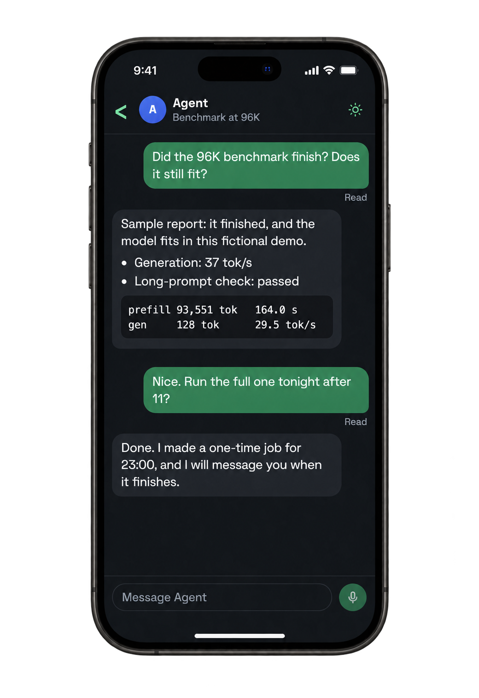
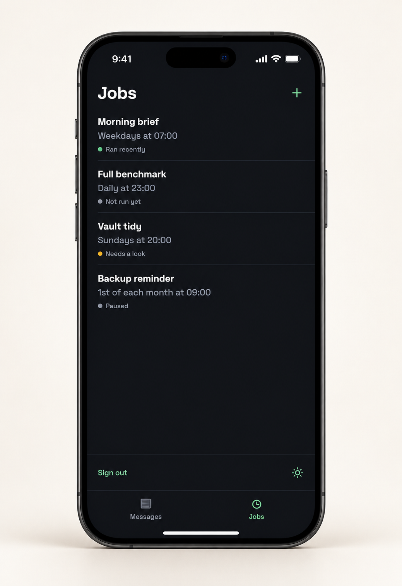

<p align="center">
  
</p>

<p align="center">A private Progressive Web App for your Hermes agent.</p>

<p align="center">
  <a href="https://github.com/calebbrinkley/roost/actions/workflows/checks.yml">
    
  </a>
</p>

<p align="center">
  · <a href="docs/setup.md">Setup</a>
  · <a href="CONTRIBUTING.md">Contributing</a>
  · <a href="SECURITY.md">Security</a>
</p>

<p align="center">
  <a href="assets/roost-iphone-chat-dark.png"></a>
  <a href="assets/roost-iphone-dark.png"></a>
</p>
<p align="center"><sub>Messages and Jobs in dark mode. AI device mockups with demo data.</sub></p>

Roost gives one owner a focused interface for conversations and scheduled work. It connects to your existing Hermes agent, keeps dashboard credentials on the server, and supports desktop and phone layouts.

## Features

- **Messages:** continue conversations from Roost and other Hermes channels, with source badges and confirmed deletion.
- **Jobs:** search, create schedules, edit instructions, pause or resume work, run a Job immediately, and view its history.
- **Settings:** system, light or dark theme per device; an accent colour shared across devices; the agent's name (Hermes's own by default); the agent's SOUL instructions; delete all conversations or Jobs; restart Roost or the Hermes gateway.

**Early preview:** text conversations and Jobs are implemented. Voice and push notifications are planned. See [compatibility and validation status](docs/compatibility.md).

## Try the demo

Requires **Python 3.11+**. The demo uses a local Hermes stand-in and disposable sample data.

```bash
git clone https://github.com/calebbrinkley/roost.git
cd roost
python3 -m venv .venv
.venv/bin/python -m pip install -e .
.venv/bin/python dev/demo.py
```

Open **http://127.0.0.1:8787** and sign in with **`roost-demo-only`**. Stop with Ctrl+C. Demo state is stored in the Git-ignored `.roost-demo-state/` directory.

## Use your agent

Follow the [setup guide](docs/setup.md) to connect a running Hermes dashboard. Roost has its own owner password and stores the dashboard password in a private file outside the checkout.

Keep Roost behind a private HTTPS front door for access from other devices. Authenticated access can submit work to your agent. Roost does not start Hermes or load models.

## Contributing

Work on a short-lived branch and open a pull request. Merges to `main` require passing repository checks and resolved review conversations; reviewer approval is optional. See [CONTRIBUTING.md](CONTRIBUTING.md) and the [repository security policy](docs/repository-security.md).

```bash
make hooks
make PYTHON=.venv/bin/python check
```

Server and interface changes also need the [demo smoke check](CONTRIBUTING.md#validation). CI uses sample data and does not validate a live deployment.

## License

[MIT](LICENSE). Bundled Space Grotesk fonts by Florian Karsten use the [SIL Open Font License](LICENSES/SpaceGrotesk-OFL.txt).
