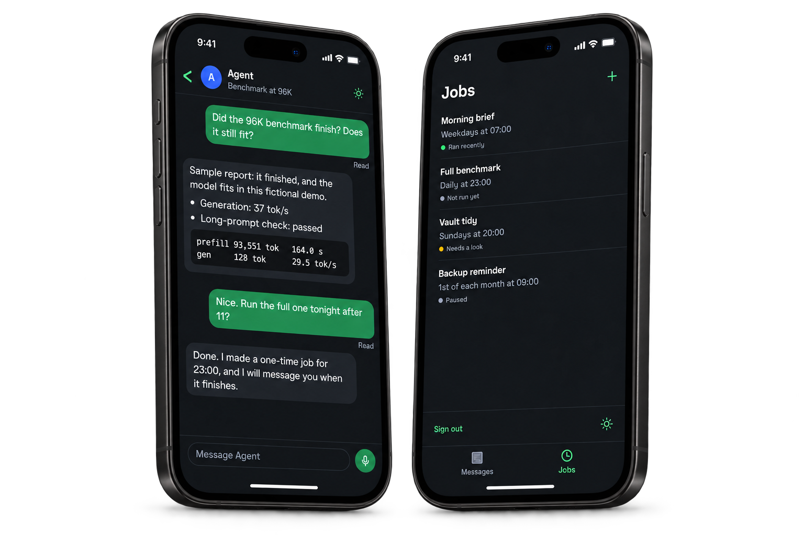

<p align="center">
  
</p>

<p align="center"><strong>A private home for your Hermes agent.</strong><br>Conversations and scheduled work in one modern, simple app.</p>

<p align="center">
  <a href="https://github.com/calebbrinkley/roost/actions/workflows/checks.yml"></a>
</p>

<p align="center">
  <a href="#try-the-demo">Try the demo</a> ·
  <a href="#install-with-your-hermes-agent">Install with Hermes</a> ·
  <a href="docs/setup.md">Setup</a> ·
  <a href="docs/compatibility.md">Compatibility</a> ·
  <a href="CONTRIBUTING.md">Contributing</a>
</p>

<p align="center">
  <a href="assets/roost-readme-hero.png"></a>
</p>

<p align="center"><sub>Illustrative device mockups with sample data. <a href="assets/roost-product-tour.gif">View the animated preview</a>.</sub></p>

Roost is a private web app for [Hermes Agent](https://github.com/NousResearch/hermes-agent). Chat with your agent and manage its scheduled work from your desktop or phone. Hermes runs the agent; Roost provides the interface.

**Early preview.** See [compatibility and validation status](docs/compatibility.md) for supported versions and device limitations.

## What you can do

- **Messages:** streaming replies, searchable conversations, instructions, and history export.
- **Jobs:** schedule work, pause or run Jobs, and view their history.
- **Voice and approvals:** dictate messages, listen to replies, and review tool requests.
- **Notifications and reply metrics:** receive updates; add the [Hermes plugin](docs/setup.md#4-optional-reply-measurements-and-job-reports-from-hermes) for Job reports, agent-initiated messages, and token/TPS details.
- **Make it yours:** themes, accent colors, agent settings, and password or passkey sign-in.

## Install with your Hermes agent

Requires **Python 3.11+** and a running Hermes dashboard with password authentication. Give Hermes this prompt:

```text
Install Roost for my existing Hermes agent from https://github.com/calebbrinkley/roost.
Read AGENTS.md and follow docs/agent-setup.md. Inspect my setup, ask for missing
details, and verify the installation before handing me the URL.
```

Prefer to install it yourself? Follow the [setup guide](docs/setup.md). Keep credentials and state outside the checkout and use private HTTPS for remote access. Dashboard credentials stay on the Roost server. See [SECURITY.md](SECURITY.md) for security reports.

On your phone, add Roost to the Home Screen. iPhone and iPad notifications require a Home Screen installation on **iOS/iPadOS 16.4+**.

## Try the demo

Requires **Python 3.11+**. Uses disposable sample data; no Hermes agent or model needed.

```bash
git clone https://github.com/calebbrinkley/roost.git
cd roost
python3 -m venv .venv
.venv/bin/python -m pip install -e .
.venv/bin/python dev/demo.py
```

Open **http://127.0.0.1:8787** and sign in with **`roost-demo-only`**.

## Development

Python server, plain HTML/CSS/JavaScript. Install the package as above, then run the checks with **Node.js 18+** available:

```bash
make hooks
make PYTHON=.venv/bin/python check
```

Run `make PYTHON=.venv/bin/python smoke` for server or interface changes. See [CONTRIBUTING.md](CONTRIBUTING.md) for the workflow and validation requirements.

## License

[MIT](LICENSE). Bundled Space Grotesk fonts by Florian Karsten use the [SIL Open Font License](LICENSES/SpaceGrotesk-OFL.txt). Asset notices are in [LICENSES](LICENSES).
